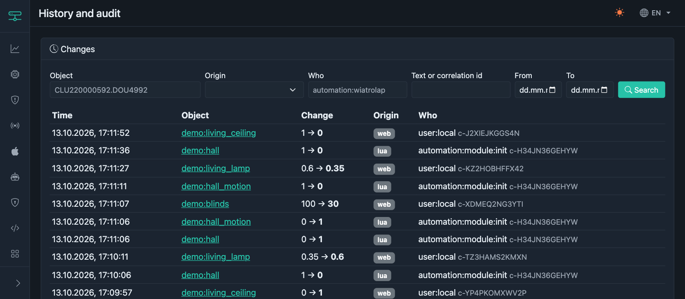
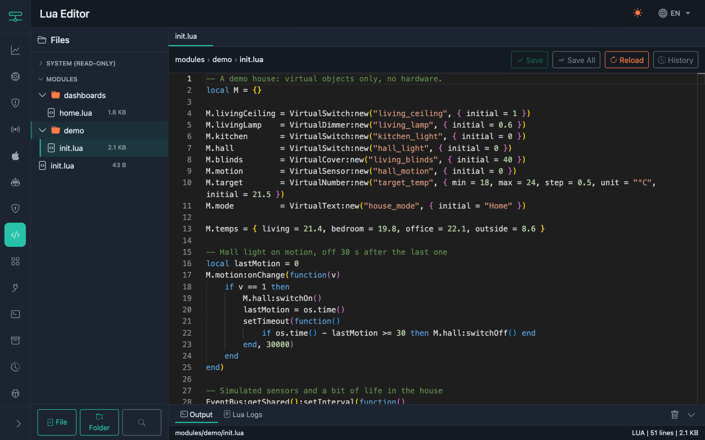

# vCLU

**Polski** | [English](README.en.md)

**Programowalny sterownik do domów z Grenton i Satel — automatyki pisane w kodzie, które agent AI może bezpiecznie zmieniać.**

[](https://github.com/Domktorymysli/vclu/actions)
[](https://go.dev)
[](LICENSE)
[](#testy-i-kontrakty)

vCLU działa obok Twoich CLU Grenton i centrali alarmowej Satel, na Raspberry Pi albo dowolnym małym komputerze z Linuksem. Rozmawia protokołem Grentona, czyta alarm i daje jedno miejsce, w którym piszesz automatyki w Lua, widzisz, co działo się w domu i kto to zrobił, oraz pozwalasz agentowi AI wprowadzać zmiany — przez sandbox, z testami i kopią zapasową każdej zmiany.

Jest dla osób z przewodowym inteligentnym domem, które chcą pisać automatyki w kodzie bez stawiania dużej instalacji Home Assistant. Home Assistant, HomeKit i MQTT są obsługiwane jako odbiorcy, ale nie są wymagane.

<!-- TODO: screenshots


-->

## Jak to wygląda

Prawdziwa automatyka z domu autora: w nocy ruch w wiatrołapie zapala światło na minutę. Jeśli ktoś zgasi je ręcznie, automatyka milknie na 10 minut. Wie, *kto* je zgasił, bo każda zmiana niesie informację o sprawcy.

```lua
-- modules/satel/wiatrolap.lua
local LIGHT = _:get("CLU220000592.DOU4992")   -- wyjście Grentona
local ME = "automation:wiatrolap"

-- Przetrwa przeładowanie Lua i restart
local state = persist("wiatrolap", { pauseUntil = 0 })

-- Czujka ruchu Satel przechodzi w 1
StateBus:watch("satel.zone.2", function()
    if not datetime.between("21:00", "06:00") or os.time() < state.pauseUntil then return end
    -- Światło zapalił ktoś inny: nie ruszamy
    local last = LIGHT:lastChange()
    if LIGHT:getValue() == 1 and not (last and last.actor == ME) then return end
    LIGHT:switchOn(60 * 1000)      -- CLU sam je zgasi po 60 s
end, { to = 1, runAs = ME })

-- Zgaszone przez kogokolwiek poza nami (włącznik, web, agent, HA): odpuszczamy
StateBus:watch("CLU220000592.DOU4992", function(e)
    if e.actor == ME then return end
    state.pauseUntil = os.time() + 600
end, { from = 1, to = 0 })
```

A to test, który agent uruchamia, zanim ta zmiana trafi na produkcję — na wirtualnym zegarze, z komendą do Grentona nagraną zamiast wysłanej:

```json
{
  "path": "modules/satel/wiatrolap.lua",
  "at": "2026-10-04T23:00:00+02:00",
  "fixtures": [{ "path": "satel.zone.2", "kind": "satel_zone", "state": 0, "config": { "number": 2 } }],
  "steps": [
    { "set": "satel.zone.2", "value": 1 },
    { "expect_clu_calls": [{ "script": "DOU4992:execute(1, 60000)" }] },
    { "advance": 61 }
  ]
}
```

## Dlaczego vCLU

**Kod, nie konfiguracja.** Automatyki, sceny, dashboardy i wirtualne urządzenia to pliki Lua. Można je czytać, porównywać, recenzować, testować i generować — Ty albo agent.

**Bezpieczny dla agentów AI w działającym domu.** Wbudowany serwer MCP nie ogranicza się do „zapal światło”. Agent pisze draft, testuje go w izolowanym sandboxie z wirtualnym zegarem, widzi diff względem produkcji i wdraża z kopią zapasową. Po wdrożeniu vCLU sprawdza, czy moduły się załadowały, i zgłasza agentowi błędy; poprzednią wersję przywraca się z kopii jednym kliknięciem. Każdy bot ma własny token i własny widok domu: obiekty mogą być dla niego `full`, `readonly` albo `hidden`.

**Wie, kto co zmienił.** Każda zmiana stanu niesie `origin` i `actor` — włącznik ścienny (`grenton`), alarm (`physical`, `device:satel`), osoba w interfejsie web (`user:<login>`), agent (`agent:<bot>`), Home Assistant (`service:home-assistant`) albo Twoja automatyka (`automation:<id>`). Historia jest zapisywana na dysku i można ją przeglądać, więc pytanie „czemu światło zapaliło się o 3 w nocy?” ma odpowiedź.

**Działa z tym, co masz.** CLU Grenton, Satel ETHM-1, liczniki energii przez Modbus TCP, urządzenia MQTT (Zigbee2MQTT, Tasmota, Shelly, ESPHome), GPIO Raspberry Pi, kamery IP. Home Assistant i Apple Home są opcjonalnymi odbiorcami.

**Mały.** Jeden program w Go plus pliki interfejsu web. W domu autora (dwa CLU, Satel, broker MQTT, historia, liczniki energii) zajmuje około 75 MB RAM i poniżej 2% CPU na x86_64. Są buildy na Raspberry Pi od pierwszego modelu (ARMv6) wzwyż.

## Możliwości

| Obszar | Co dostajesz |
|---|---|
| **Środowisko Lua** | gopher-lua z przeładowaniem na gorąco, jedna pętla zdarzeń z przechwytywaniem paniki, timery (`after`, `every`, `setTimeout`, `setInterval`), `StateBus:watch` z filtrami `from`/`to`/`actor`, sceny, moduły `json`/`xml`/`datetime` ze strefami czasowymi i `datetime.between`, Logger, magazyn KV |
| **Obiekty** | Proxy Grentona generowane z projektu OM; wirtualne przełączniki, ściemniacze, rolety, czujniki, liczby i teksty z `initial` i `persist`; `persist(name, defaults)` na stan automatyki, który przetrwa restart |
| **Historia i audyt** | Każda zmiana z `old`, `value`, `origin`, `actor`, `correlationId`; dzienne pliki na dysku (domyślnie 90 dni / 1 GB, zapis wsadowy, żeby oszczędzać kartę SD); odtwarzana po restarcie bez fałszywych zmian; `obj:lastChange()`, `obj:since()`, `obj:history(n)` w Lua; Narzędzia → Historia i audyt w interfejsie web; dostęp przez REST i MCP |
| **Kontrola szumu** | `expose(..., { filter = { delta = 0.2, heartbeat = 600 } })` sprawia, że czujnik skaczący o 0,1 °C nie zalewa historii, MQTT i HomeKit; `getValue()` zostaje surowe |
| **Agenci AI (MCP)** | 32 narzędzia, zasoby i prompty: sterowanie urządzeniami, wyszukiwanie w kodzie, logi, metryki, historia, sandbox z testami scenariuszy, diff, wdrożenie z kopią zapasową i kontrolą ładowania modułów, log audytu, incydenty, pamięć agenta, wykrywanie urządzeń MQTT |
| **Grenton** | Działa jako CLU w sieci (szyfrowane wykrywanie, TFTP, zapytania o skrypty) i jako klient prawdziwych CLU (komendy, subskrypcje stanu z odnawianiem); importuje `om.lua` z Object Managera i generuje proxy dla wyjść, wejść, ściemniaczy, RGB, rolet, wejść/wyjść analogowych, 1-Wire i czujników paneli |
| **Satel** | Integracja z ETHM-1: wejścia, strefy, wyjścia, temperatury ATD-100, uzbrajanie; rozbrajanie i wymuszone uzbrojenie są wyłączone, dopóki ich nie dopuścisz; nazwy czytane z centrali |
| **MQTT i Home Assistant** | Wbudowany broker MQTT (mochi-mqtt) i klient; discovery Home Assistant z `device_class`/`state_class`, więc liczniki energii działają w panelu Energia HA; wykrywanie urządzeń Zigbee2MQTT, Tasmota, Shelly, ESPHome i HA z podpowiedzią kodu Lua |
| **HomeKit** | Natywny mostek: przełączniki, światła, ściemniacze, rolety, czujniki ruchu i binarne, temperatura, wilgotność, wentylatory, sceny |
| **Modbus** | Modbus TCP przez bramki RS485 (kody funkcji 1–4, 6, 16), asynchronicznie, jedna transakcja naraz na bramkę |
| **Więcej sprzętu** | Wejścia i wyjścia GPIO Raspberry Pi z eliminacją drgań styków i zdarzeniami wciśnięcia/przytrzymania; klient i serwer HTTP w Lua; proxy zdjęć z kamer IP (dane logowania nie trafiają do przeglądarki) |
| **Dashboardy** | Definiowane w Lua, serwowane pod `/d/<id>` dla tabletów ściennych: przełączniki, suwaki, przyciski, listy wyboru, kafelki statusu z wykresikami, wykresy, obrazy, ściemniacze, rolety, kolory; motywy, grupy zakładek, dashboardy zmieniające się z porą dnia; dostęp publiczny, przez sesję albo PIN |
| **Metryki** | Szeregi czasowe z Lua (`metric(...)`) do wykresów; Prometheus `/metrics` z ponad 30 seriami i gotowe dashboardy Grafany w `grafana/` |
| **Pluginy** | Pluginy Lua w sandboxie, z repozytorium GitHub, z własnym magazynem KV, timerami, HTTP i MQTT; pisane jako fabryki, więc jeden plugin obsłuży wiele urządzeń |
| **Interfejs web** | Kreator konfiguracji, status, edytor kodu Monaco z walidacją i wyszukiwaniem, import Grenton/OM, MQTT, Satel, HomeKit, profile dostępu, boty MCP i drafty, pluginy, kopie zapasowe z harmonogramem, historia i audyt, podgląd logów na żywo, statystyki, dokumentacja REST API (ReDoc); po polsku i angielsku |
| **Bezpieczeństwo** | Hasła bcrypt, 12-godzinne sesje z ciasteczkami SameSite=Strict i tokenami CSRF, klucze API i tokeny botów przechowywane jako skróty SHA-256, profile dostępu per obiekt dla MQTT, HomeKit i MCP |

## Szybki start

### Gotowe wydanie

Archiwa dla Linuksa (amd64, arm64, armv7, armv6) i macOS (arm64) zawierają program, pliki interfejsu web i instalator usługi systemd:

```bash
mkdir vclu && tar -xzf vclu-linux-arm64.tar.gz -C vclu
cd vclu && sudo ./install.sh
```

### Docker

```bash
docker run -d --name vclu \
  --network host \
  -v vclu-data:/data \
  ghcr.io/domktorymysli/vclu:latest
```

`--network host` jest potrzebne do broadcastu UDP (wykrywanie Grentona) i mDNS (HomeKit).

### Ze źródeł

```bash
git clone https://github.com/Domktorymysli/vclu.git
cd vclu
go build -o vclu ./cmd/vclu
./vclu --auto --data-dir ./data
```

Otwórz `http://localhost:8080`. Kreator konfiguracji zapyta o rolę urządzenia, klucze Grentona i hasło administratora, a także może zaimportować Twój projekt z Object Managera.

Przydatne flagi: `--auto` (sam wybiera interfejs sieciowy), `--interface`, `--ip`, `--data-dir`, `--web-port`, `--list` (pokazuje interfejsy), `--verbose`.

## Pisanie automatyk

Automatyki leżą w `modules/` i są ładowane z `modules/init.lua`:

```lua
-- modules/init.lua
datetime.setTimezone("Europe/Warsaw")
require("satel/wiatrolap")
require("tasmota_desk")
require("dashboards/home")
```

Gniazdko Tasmota jako przełącznik, widoczny w interfejsie web, Home Assistant i Apple Home:

```lua
-- modules/tasmota_desk.lua  (MQTT = domyślny klient, Integracje → MQTT → Client)
local lamp = VirtualSwitch:new("Desk lamp")

MQTT:subscribe("stat/tasmota_desk/POWER", function(topic, payload)
    lamp:updateState(payload == "ON" and 1 or 0)
end)
lamp:onSwitchOn(function()  MQTT:publish("cmnd/tasmota_desk/Power", "ON")  end)
lamp:onSwitchOff(function() MQTT:publish("cmnd/tasmota_desk/Power", "OFF") end)

expose(lamp, "switch", { name = "Lampka na biurku", path = "tasmota:desk", area = "Gabinet" })
```

Obiekty Grentona z projektu OM, z filtrem szumu na termometrach 1-Wire:

```lua
local TEMP = { delta = 0.2, heartbeat = 600 }
expose(_:get("CLU220000592.ONE6305"), "temperature", { name = "Temperatura", area = "Salon", filter = TEMP })
expose(_:get("CLU220000592.DOU0789"), "light", { name = "Sofa", area = "Salon" })
```

Ustawienie, które przetrwa restart:

```lua
local nightMode = VirtualSwitch:new("night_mode", { initial = 0, persist = true })
expose(nightMode, "switch", { name = "Tryb nocny" })
```

Dashboard na tablet ścienny:

```lua
local r = _registry
Dashboard.new("home")
  :name("Dom"):icon("house-door"):auth("pin"):pin("1234")
  :section("Salon", "lamp")
    :toggle("sofa", "Sofa", "lamp",
      function() return r:get("CLU220000592.DOU0789"):getValue() end,
      function(v) local o = r:get("CLU220000592.DOU0789"); if v then o:switchOn() else o:switchOff() end end)
    :status("temp", "Temperatura", "thermometer-half",
      function() return r:get("CLU220000592.ONE6305"):getValue() end, "°C")
  :build()
```

Więcej wzorców: [`docs/ai/examples.md`](docs/ai/examples.md). Pełne API: [`docs/ai/lua-api-reference.md`](docs/ai/lua-api-reference.md) (oba po angielsku).

## Agenci AI

Utwórz bota w interfejsie web (strona MCP) i podłącz dowolnego klienta MCP — Claude Code, Codex CLI, Gemini CLI i inne:

```json
{
  "mcpServers": {
    "vclu": {
      "type": "http",
      "url": "http://ADRES_VCLU:8080/mcp",
      "headers": { "Authorization": "Bearer TOKEN_BOTA" }
    }
  }
}
```

To, co bot może zrobić, zależy od jego ustawień:

| Poziom | Narzędzia |
|---|---|
| **Sterowanie** (każdy bot) | lista urządzeń, odczyt i ustawianie stanu, wywoływanie metod, uruchamianie scen, odczyt historii zmian — tylko dla obiektów, na które pozwala jego profil dostępu |
| **Tryb Dev** | odczyt i przeszukiwanie plików, logi, konfiguracja (bez sekretów), rejestr, metryki, dashboardy, konfiguracja pluginów, schemat runtime, przeładowanie; drafty: zapis, walidacja, testy scenariuszy, diff, wdrożenie, usuwanie; log audytu; wykrywanie MQTT; pamięć agenta |
| **Tryb Exec** | uruchomienie fragmentu Lua na działającym runtime (maks. 8 KB) |

Tryb Dev ma też globalny wyłącznik w interfejsie web. Typowa zmiana wprowadzana przez agenta:

1. Przeczytaj opis domu, rejestr urządzeń i historię obiektów, których dotyczy zmiana.
2. Napisz draft w `modules/`.
3. Zwaliduj go i przetestuj w sandboxie: wirtualny zegar, nagrywane komendy do Grentona, fixtures dla wejść Satela, kroki `set`, `advance`, `reload`, `expect_state`, `expect_clu_calls`, `expect_history`.
4. Pokaż diff, wdróż z kopią zapasową, sprawdź, czy moduły się załadowały, i obserwuj logi. Poprzednią wersję przywrócisz z kopii w edytorze.
5. Każdy krok trafia do logu audytu, a każda zmiana, którą automatyka zrobi później, niesie jej sprawcę.

## Historia i audyt

- **Kto to zmienił:** każda zmiana zapisuje `origin` i `actor`. Każdy kanał sam ustawia sprawcę: użytkownicy web, klucze API, boty, HomeKit, MQTT i Home Assistant, raporty Grentona, Satel, moduły i pluginy. `switchOn(ms)` na wyjściu Grentona przypisuje nawet samoczynne wyłączenie przez CLU tej komendzie, która je zapoczątkowała.
- **W Lua:** `obj:lastChange()`, `obj:since()`, `obj:history(n)`, `StateBus:watch(path, fn, { actor = ... })`.
- **Na dysku:** jeden plik JSONL na dzień, zapis co 5 minut i przy wyłączaniu, uprawnienia 0600, ucięta ostatnia linia po zaniku zasilania jest pomijana. Retencję i limity rozmiaru ustawiasz w interfejsie.
- **W interfejsie web:** filtrowanie po obiekcie, źródle, sprawcy, tekście i czasie; podgląd zużycia pamięci i dysku oraz błędów zapisu; zmiana limitów na żywo.
- **API:** `GET /api/history` z filtrami i stronicowaniem kursorem, `vclu_device_history` dla botów (obiekty ukryte przed botem są pomijane).

## Architektura

```
cmd/vclu/            punkt wejścia i flagi
pkg/
  lua/               maszyna wirtualna Lua, powiązania z Go (HTTP, MQTT, Modbus, GPIO, Satel, historia)
    runtime/         runtime Lua: rdzeń, obiekty Grentona, obiekty wirtualne, integracje
  server/            protokół UDP Grentona: wykrywanie, komendy, subskrypcje CLU
  cipher/ tftp/      szyfrowanie Grentona i TFTP
  omparser/          parser projektu Object Managera i generator proxy
  satel/             klient Satel ETHM-1
  history/           historia zmian stanu: bufory w pamięci, pliki dzienne, wyszukiwanie
  mcp/               serwer MCP, sandbox, scenariusze, audyt, incydenty
  workspace/         drafty, kopie zapasowe, wdrożenie i wycofanie
  web/               interfejs web i REST API (Gin)
  broker/            wbudowany broker MQTT
  homekit/           mostek HomeKit
  accesscontrol/     profile dostępu per obiekt i integracja
  metrics/ stats/    szeregi czasowe i Prometheus
  plugins/           repozytorium pluginów, loader, magazyn KV
  camera/            proxy zdjęć z kamer
web/                 szablony, JS, CSS, dołączone biblioteki (działa offline), tłumaczenia en/pl
deploy/              unit systemd i instalator
grafana/             dashboardy Grafany dla metryk Prometheusa
```

Go zajmuje się siecią, szyfrowaniem, współbieżnością i plikami. Lua zajmuje się domem: obiektami, automatykami, scenami, dashboardami — wszystkim, co edytujesz Ty albo agent. Cały kod Lua działa w jednej pętli zdarzeń, więc automatyki nigdy się ze sobą nie ścigają.

## Testy i kontrakty

```bash
go test ./...          # ponad 900 testów, bez sprzętu i sieci
go test -race ./...    # CI uruchamia to przy każdym pushu
```

Zachowanie, na którym polegają automatyki, pluginy i integracje — jedna zmiana daje dokładnie jedno zdarzenie, informacja o sprawcy, kontrola dostępu, bezpieczne przeładowanie, trwałość stanu, historia, sandbox i protokół Grentona — jest przypięte testami kontraktowymi. Lista i zasady: [CONTRIBUTING.md](CONTRIBUTING.md#contracts) (po angielsku).

## Instalacja produkcyjna

| | |
|---|---|
| Platformy | Linux amd64, arm64, armv7, armv6 (Raspberry Pi 1 i nowsze); macOS arm64 |
| Porty | web 8080, Grenton UDP 1234, TFTP 69, MQTT 1883, HomeKit 5123 |
| Dane | jeden katalog danych: `.vclu.json`, moduły, KV, historia, kopie zapasowe |
| Usługa | `deploy/vclu.service` (systemd) i `deploy/install.sh` |

Wszystko konfiguruje się w interfejsie web. Ustawienia są w pliku `.vclu.json` w katalogu danych.

## Współtworzenie

Zmiany są mile widziane, także te pisane z pomocą agentów AI — po to są testy kontraktowe. Szczegóły w [CONTRIBUTING.md](CONTRIBUTING.md).

## Demo

[](https://www.youtube.com/watch?v=POgNGuUyhSU)

Wprowadzenie do vCLU: instalacja na Raspberry Pi, GPIO, MQTT, integracja z Home Assistant.

## Linki

- [vclu.pl](https://vclu.pl/) — strona projektu
- [docs.vclu.pl](https://docs.vclu.pl) — dokumentacja
- [domktorymysli.org](https://domktorymysli.org/) — blog autora: Dom który myśli
- [Facebook: Dom który myśli](https://www.facebook.com/domktorymysli)
- [Discord](https://discord.gg/9cgrnXkVP) — społeczność vCLU: pytania i pomoc

## Dokumentacja

- [docs.vclu.pl](https://docs.vclu.pl)
- [Dokumentacja API Lua](docs/ai/lua-api-reference.md) i [wzorce kodu](docs/ai/examples.md) (po angielsku; agenci dostają je też przez MCP)

## Licencja

[Business Source License 1.1](LICENSE): bezpłatna dla prywatnych i komercyjnych instalacji inteligentnego domu; nie wolno na bazie vCLU budować konkurencyjnego sterownika. Każde wydanie po 4 latach przechodzi na licencję Apache 2.0.
